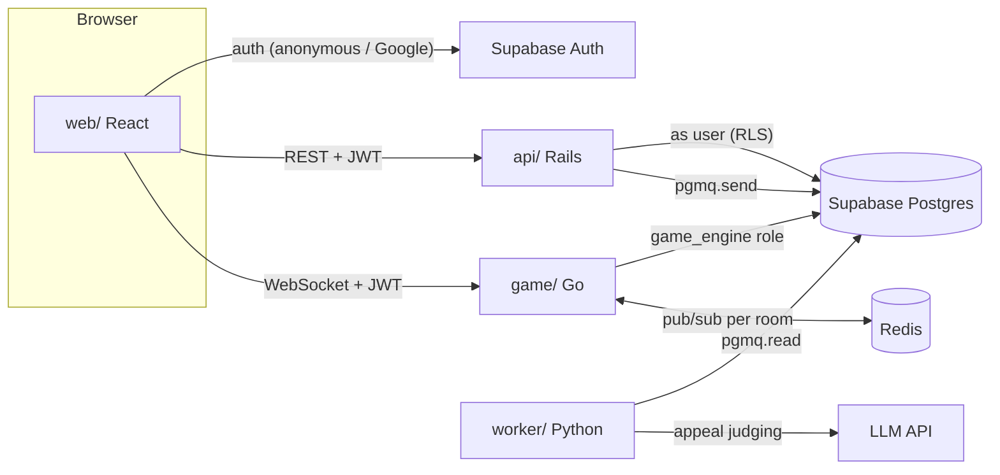

# System Overview

## A game, end to end

1. **Sign in.** The web client signs in anonymously with Supabase Auth on first visit. The JWT goes with every REST call and the socket connect.
2. **Create a room.** `POST /v1/rooms` (api) inserts the room with the host's season choice. A trigger makes the caller its host. No board yet.
3. **Start and build the board.** When the host presses Start, the game server calls `start_game()`. In one transaction it records the game and everyone in it, then builds a board from whole categories that none of the contestants has seen, and writes `board_clues` (category, value, position, catalog reference; never clue text or the response). See [game history](../../product-docs/features/game-history/feature-brief.md).
4. **Join.** Before Start, players call `POST /v1/rooms/join` with the code. The `join_room()` function checks capacity. The response carries the room's socket URL.
5. **Play.** Each player opens `GET /rooms/{id}/ws` on the game server. One instance owns the room (Redis lease) and runs its state machine: select clue → read → buzzing opens → first valid buzz wins → answer → judge → score. Every state change is a `ServerMessage` with an increasing `seq`, published to the room's Redis channel and relayed by whichever instance holds each player's socket.
6. **Judge.** Go's `judge` package returns a verdict instantly. The host can override it. A disputed answer can be appealed to the worker's LLM judge.
7. **Record as it happens.** Each revealed clue is recorded as seen by everyone in the game, and each judged answer is written when it is judged. At the end the game is marked finished (or abandoned) and the room reopens for a rematch. The api serves history from `games` and the `game_results` view.

## Who owns what

| Data | Writer | Readers |
|---|---|---|
| `profiles` | api (as user) | api, game |
| `rooms`, `room_members` | api (create, join, leave); game (status) | api, game |
| `clues` (catalog) | worker (owner role, imports) | game_engine only |
| `board_clues`, `games`, `game_players`, `answers` | game (game_engine functions) | game members, permanently (read-only); game |
| `seen_clues` | game (game_engine functions) | game_engine only |
| Live phase, timers, buzz order | game, in memory + Redis | clients via WebSocket |

See [data-and-isolation.md](./data-and-isolation.md), [realtime-game-server.md](./realtime-game-server.md), and [api-contract.md](./api-contract.md).
