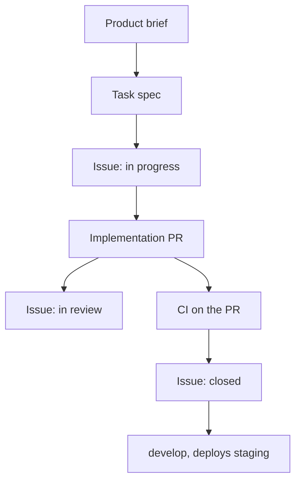

# Development Workflow

**Source of truth:** `.github/workflows/`, `.github/scripts/`

How work goes from a request to merged code. Branch names and merge rules are in [branch-strategy.md](./branch-strategy.md); releases are in [release-strategy.md](../operations/release-strategy.md). The stack is in [stack.md](./stack.md).

Tasks are tracked as GitHub issues. A task's key is `GH-{N}`, where `{N}` is its issue number; GitHub links `GH-{N}` to the issue wherever it appears.

---

## Lifecycle at a glance



Every task branch starts from and targets `develop`. CI runs on every PR into `develop` and must be green before it merges; each merge deploys staging, except docs-only merges.

| Step | Owner | What happens | Issue |
|---|---|---|---|
| 1. Scope | `/product` | Writes `tasks/{task-name}/product-brief.md`; PR to `develop` | — |
| 2. Plan | `/engineering` | Writes `task-brief.md` in the same folder; PR to `develop` | **Created** when the PR opens; **in progress** when it merges |
| 3. Implement | Implementation agent (`/implement`, or any coding agent reading [AGENTS.md](../../../AGENTS.md)) | Fresh branch from `develop`; one PR; final commit deletes the task folder | **In review** when the PR opens |
| 4. Done | Human merges once CI is green | Staging deploys | **Closed** when the PR merges |
| 5. Release | `/engineering`, human-triggered | See [release-strategy.md](../operations/release-strategy.md) | — |

**No agent creates, edits, labels, or closes a task issue.** Every issue write happens in GitHub Actions, triggered by PR events. Reading issues with `gh` is fine.

### The task folder is the state machine

| Path in git | Issue state |
|---|---|
| `tasks/{name}/product-brief.md` | No issue yet |
| `tasks/{name}-GH-{N}/task-brief.md` added (spec PR merged) | `status:in-progress` |
| that `task-brief.md` removed (implementation PR opened) | `status:in-review` |
| that removal merged | Closed as completed |

The workflows pattern-match on the PR's file-status list (added, renamed, removed). No webhook is involved.

---

## Step 1 — Scope with `/product`

Output: one PR to `develop` adding `tasks/{task-name}/product-brief.md`, with task frontmatter (`task-type`, `task-title`). Merging it does not create an issue. New features and enhancements first update the durable docs in `docs/product-docs/features/{name}/` in their own PR.

## Step 2 — Plan with `/engineering`

`/engineering` writes `task-brief.md` and opens a PR to `develop`. When the PR **opens**, `create-task-issue.yml`:

1. creates the issue from the frontmatter and the markdown body, labelled `task`, `type:{task-type}`, `status:planned`, and comments `Tracking issue: GH-{N}` on the PR (a spec longer than about 65,000 characters is cut at a line break, with a link to the full file)
2. writes `.task-meta.yml` into the folder
3. renames the folder to `tasks/{task-name}-GH-{N}/`

Re-running the workflow on the same spec reuses its issue (found by the `<!-- task-folder: {task-name} -->` marker in the body), so it never makes a duplicate. If the spec PR is closed without merging, the issue gets a comment and stays open.

`/engineering` pulls the branch, adds the branch table, gets human approval, and merges. On merge the issue moves to `status:in-progress` and its body is replaced with the merged spec.

## Step 3 — Implement

The implementation agent branches fresh from `develop` as `{task-type}/GH-{N}-{task-name}` and reads, before editing:

- `tasks/{task-name}-GH-{N}/task-brief.md` and `product-brief.md`
- [stack.md](./stack.md) "Access patterns"
- this file and [branch-strategy.md](./branch-strategy.md)

Rules: preserve the contracts in `shared/` unless the spec says to change them; never weaken types; update docs when behavior changes; run validation for every package touched.

Player-visible changes: agent QA on the local stack per [agent-qa.md](../quality/agent-qa.md), with the evidence record on the PR.

### Validation: targeted tests only

**Never run a full test suite locally as routine validation.** Run the tests for the files you touched. CI runs everything, path-filtered, on the PR into `develop`, and the PR merges only when it is green.

```bash
mise run test:web -- src/pages/Home.test.tsx
mise run test:game -- ./internal/room/...
mise run test:api -- ./internal/rooms/...
mise run test:worker -- tests/test_clue_import.py
mise run db:test                       # only when supabase/ changed
mise run gen                           # only when shared/ changed; commit the output
```

## Step 4 — Implementation PR

One PR to `develop`. Its final commit:

```bash
git rm -r "tasks/{task-name}-GH-{N}/"
git commit -m "chore: delete task folder for GH-{N}"
```

Title: `[{Task Type}] GH-{N}: {brief description}`. Opening it moves the issue to `status:in-review`; merging closes the issue and deploys staging. CI must be green before it merges. The implementation agent never merges.

**Merge `origin/develop` into the task branch before opening the PR.** GitHub returns no file list for a PR opened with conflicts, so the in-review transition would never fire.

## Step 5 — Release

See [release-strategy.md](../operations/release-strategy.md).

---

## Keeping docs accurate

`docs/` describes the system as it is built.

- **When docs and code disagree, the code wins.** Fix the doc in the same PR. The exception is when the code is the bug; then open a `bug-fix` task.
- **Every implementation PR updates the docs it makes untrue.** The task spec lists them under "Docs to update", and the review (`/engineering` Phase C) checks them.
- **Each system doc names its source of truth** in a `**Source of truth:**` line under its title: the files that implement it.
- **Unbuilt work is marked "Not yet implemented."** Never describe a plan in the present tense.
- **Audit the docs against the code before each minor release.**

## Automation map

| Workflow | Trigger | Result |
|---|---|---|
| `create-task-issue.yml` | PR opened into `develop` that adds a `tasks/**/task-brief.md` (edits and deletions are ignored); manual (`files`) | Creates the issue, commits `.task-meta.yml`, renames the folder. Task names must match `^[a-z0-9-]+$`. One issue per spec PR. A manual run on a spec branch pushes the rename to it; on `develop` it pushes `chore/assign-GH-{N}` instead and links the PR to open (Actions can't open PRs in this repo). |
| `task-issue-transitions.yml` | PR opened / closed; manual (`issue`, `step`) | Spec merged → `status:in-progress`; spec closed unmerged → comment; implementation opened → `status:in-review`; merged → closed. |
| `ci.yml` | PR into `develop` or `production`; weekly; manual | Path-filtered checks per package; `CI Complete` must pass before a PR merges. Docs/task-only PRs skip the package jobs. |
| `deploy-staging.yml` | Push to `develop` (every merged PR, except docs-only: only `docs/`, `tasks/`, `releases/` or `.md` files); manual | Calls `deploy.yml` for staging: migrations (the release rehearsal), deploy, deployed-commit verification. |
| `deploy-prod.yml` | Push to `production`; manual | Calls `deploy.yml` for production: migrations, deploy, deployed-commit verification. |

## Issue labels

`create-task-issue.yml` creates these labels the first time it runs, so there is nothing to set up. It uses the workflow's own `GITHUB_TOKEN`: no secrets.

| Label | Meaning |
|---|---|
| `task` | A tracking issue for a task folder |
| `type:new-feature`, `type:enhancement`, `type:improvement`, `type:bug-fix` | The task type from the frontmatter |
| `status:planned` | Spec PR open |
| `status:in-progress` | Spec merged |
| `status:in-review` | Implementation PR open |

Done is a closed issue (reason: completed). A spec that merged without an issue (before 2026-11-20, when tasks had no tracker) gets one by hand: `gh workflow run create-task-issue.yml --ref develop -f files=tasks/{name}/task-brief.md`, open the PR it links, then `gh workflow run task-issue-transitions.yml --ref develop -f issue={N} -f step=inProgress`.

## Parallel work

One git worktree per task, as siblings of the main checkout:

```text
~/schmegettes/
~/schmegettes-GH-12/
~/schmegettes-GH-13/
```
