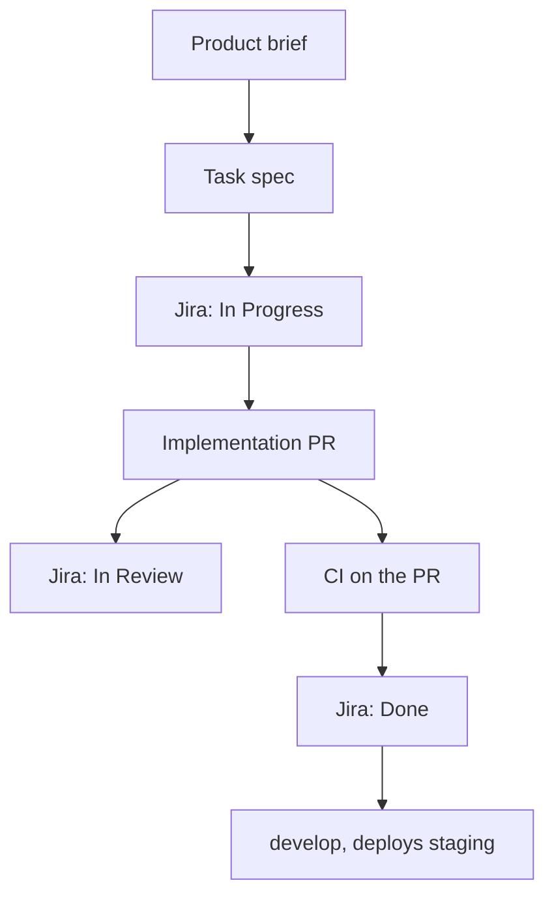

# Development Workflow

**Source of truth:** `.github/workflows/`, `.github/scripts/`, `.github/jira.json`

How work goes from a request to merged code. Branch names and merge rules are in [branch-strategy.md](./branch-strategy.md); releases are in [release-strategy.md](../operations/release-strategy.md). The stack is in [stack.md](./stack.md).

The Jira project key is `SCH` (set in [`.github/jira.json`](../../../.github/jira.json)). Docs write it as `SCH-{N}`.

---

## Lifecycle at a glance



Every task branch starts from and targets `develop`. CI runs on every PR into `develop` and must be green before it merges; each merge deploys staging.

| Step | Owner | What happens | Jira |
|---|---|---|---|
| 1. Scope | `/product` | Writes `tasks/{task-name}/product-brief.md`; PR to `develop` | — |
| 2. Plan | `/engineering` | Writes `task-brief.md` in the same folder; PR to `develop` | Ticket **created** when the PR opens; **In Progress** when it merges |
| 3. Implement | Implementation agent (`/implement`, or any coding agent reading [AGENTS.md](../../../AGENTS.md)) | Fresh branch from `develop`; one PR; final commit deletes the task folder | **In Review** when the PR opens |
| 4. Done | Human merges once CI is green | Staging deploys | **Done** when the PR merges |
| 5. Release | `/engineering`, human-triggered | See [release-strategy.md](../operations/release-strategy.md) | — |

**No agent calls the Jira API.** Every Jira write happens in GitHub Actions, triggered by PR events.

### The task folder is the state machine

| Path in git | Ticket state |
|---|---|
| `tasks/{name}/product-brief.md` | No ticket yet |
| `tasks/{name}-SCH-{N}/task-brief.md` added (spec PR merged) | In Progress |
| that `task-brief.md` removed (implementation PR opened) | In Review |
| that removal merged | Done |

The workflows pattern-match on the PR's file-status list (added, renamed, removed). There is no Jira webhook.

---

## Step 1 — Scope with `/product`

Output: one PR to `develop` adding `tasks/{task-name}/product-brief.md`, with Jira frontmatter (`jira-type`, `jira-title`). Merging it does not create a ticket. New features and enhancements first update the durable docs in `docs/product-docs/features/{name}/` in their own PR.

## Step 2 — Plan with `/engineering`

`/engineering` writes `task-brief.md` and opens a PR to `develop`. When the PR **opens**, `create-jira-ticket.yml`:

1. creates the ticket from the frontmatter and the markdown body (keep `task-brief.md` under about 30,000 characters, Jira's description limit)
2. writes `.jira-meta.yml` into the folder
3. renames the folder to `tasks/{task-name}-SCH-{N}/`

`/engineering` pulls the branch, adds the branch table, gets human approval, and merges. On merge the ticket moves to **In Progress** and its description is replaced with the merged spec.

## Step 3 — Implement

The implementation agent branches fresh from `develop` as `{task-type}/SCH-{N}-{task-name}` and reads, before editing:

- `tasks/{task-name}-SCH-{N}/task-brief.md` and `product-brief.md`
- [stack.md](./stack.md) "Access patterns"
- this file and [branch-strategy.md](./branch-strategy.md)

Rules: preserve the contracts in `shared/` unless the spec says to change them; never weaken types; update docs when behavior changes; run validation for every package touched.

### Validation: targeted tests only

**Never run a full test suite locally as routine validation.** Run the tests for the files you touched. CI runs everything, path-filtered, on the PR into `develop`, and the PR merges only when it is green.

```bash
mise run test:web -- src/pages/Home.test.tsx
mise run test:game -- ./internal/room/...
mise run test:api -- ./internal/rooms/...
mise run test:worker -- tests/test_clue_import.py
mise run db:test                       # only when supabase/ changed
mise run gen                           # only when shared/ changed; commit the output
```

## Step 4 — Implementation PR

One PR to `develop`. Its final commit:

```bash
git rm -r "tasks/{task-name}-SCH-{N}/"
git commit -m "chore: delete task folder for SCH-{N}"
```

Title: `[{Task Type}] SCH-{N}: {brief description}`. Opening it moves the ticket to **In Review**; merging moves it to **Done** and deploys staging. CI must be green before it merges. The implementation agent never merges.

**Merge `origin/develop` into the task branch before opening the PR.** GitHub returns no file list for a PR opened with conflicts, so the In Review transition would never fire.

## Step 5 — Release

See [release-strategy.md](../operations/release-strategy.md).

---

## Keeping docs accurate

`docs/` describes the system as it is built.

- **When docs and code disagree, the code wins.** Fix the doc in the same PR. The exception is when the code is the bug; then open a `bug-fix` task.
- **Every implementation PR updates the docs it makes untrue.** The task spec lists them under "Docs to update", and the review (`/engineering` Phase C) checks them.
- **Each system doc names its source of truth** in a `**Source of truth:**` line under its title: the files that implement it.
- **Unbuilt work is marked "Not yet implemented."** Never describe a plan in the present tense.
- **Audit the docs against the code before each minor release.**

## Automation map

| Workflow | Trigger | Result |
|---|---|---|
| `create-jira-ticket.yml` | PR opened into `develop` touching `tasks/**/task-brief.md` | Creates the ticket, commits `.jira-meta.yml`, renames the folder. Task names must match `^[a-z0-9-]+$`. One ticket per spec PR. |
| `jira-transitions.yml` | PR opened / merged | Spec merged → In Progress; implementation opened → In Review; merged → Done. |
| `ci.yml` | PR into `develop` or `production`; weekly; manual | Path-filtered checks per package; `CI Complete` must pass before a PR merges. Docs/task-only PRs skip the package jobs. |
| `deploy-staging.yml` | Push to `develop` (every merged PR); manual | Calls `deploy.yml` for staging: migrations (the release rehearsal), deploy, deployed-commit verification. |
| `deploy-prod.yml` | Push to `production`; manual | Calls `deploy.yml` for production: migrations, deploy, deployed-commit verification. |

## Jira setup (once per Jira project)

**Not yet done for this repo.** The issue-type IDs in `.github/jira.json` are `REPLACE_ME` and the `JIRA_*` repo secrets are not set, so `create-jira-ticket.yml` fails and no ticket is created. Until then, task folders keep their names, branches carry no `SCH-{N}`, and PR titles use the task name in its place.

These values are instance-specific. Look them up; never copy them from another repo. All of them live in `.github/jira.json`.

1. Create the Jira project. Put its key in `projectKey`.
2. Issue type IDs: `GET /rest/api/3/issuetype/project?projectId={id}`. Map `new-feature`, `enhancement`, `improvement`, `bug-fix` to IDs in `issueTypes`.
3. Make sure the Jira workflow has transitions named exactly `In Progress`, `In Review`, `Done` (or change `transitions`). A transition not reachable from the current status is logged and skipped.
4. Repo secrets: `JIRA_URL`, `JIRA_EMAIL`, `JIRA_API_TOKEN`.

## Parallel work

One git worktree per task, as siblings of the main checkout:

```text
~/schmegettes/
~/schmegettes-SCH-12/
~/schmegettes-SCH-13/
```
